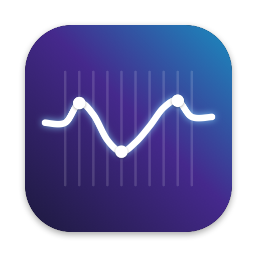
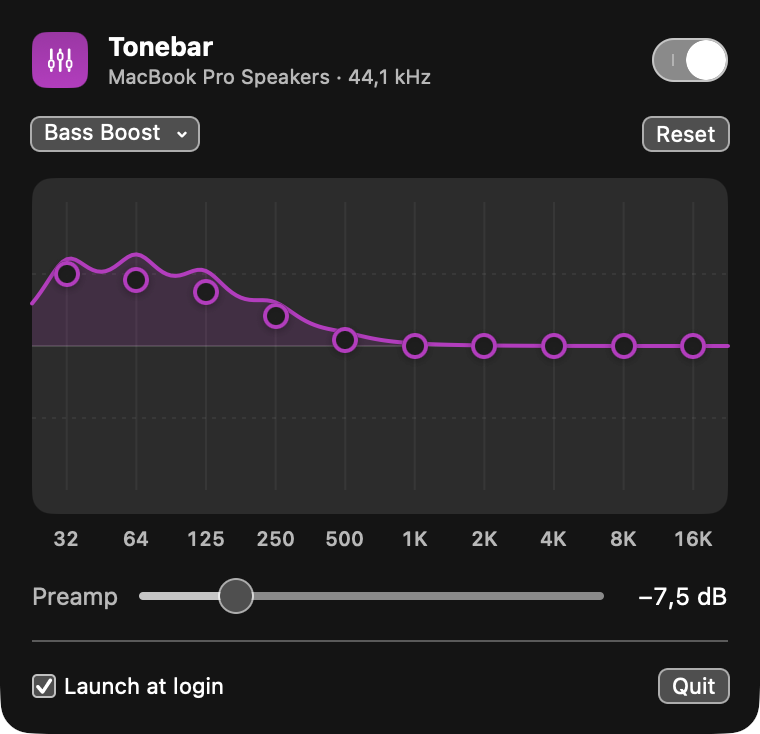

<p align="center"></p>

<h1 align="center">Tonebar</h1>

<p align="center">A small system-wide equalizer for the macOS menu bar.<br>No audio drivers, no virtual devices — one ~2 MB app.</p>

<p align="center"></p>

## Features

- **10-band graphic EQ** (32 Hz – 16 kHz, ±12 dB) applied to everything your Mac plays.
- **Live response curve.** Drag a knob to set a band, double-click it to reset.
- **11 presets** — Bass Boost, Loudness, Vocal, Podcast, Laptop Speakers and more — each with headroom so it doesn't clip.
- **Built-in peak limiter.** Boosts never push the output past full scale, so loud tracks don't crackle.
- **Follows your output.** Plug in headphones or switch to AirPods and the EQ moves with you. Tonebar never reads a headset's microphone.
- **Launches at login**, lives only in the menu bar, takes about 0.2 % CPU while processing and doesn't keep your Mac awake.

## Install

Requires **macOS 15 or later**.

1. Download `Tonebar.zip` from the [latest release](../../releases/latest), unzip it and move **Tonebar.app** to `/Applications`.
2. The release is not notarized, so macOS blocks the first launch. Clear the quarantine flag once:
   ```bash
   xattr -dr com.apple.quarantine /Applications/Tonebar.app
   ```
3. Open Tonebar and click **Allow** when macOS asks for **System Audio Recording** access.

Tonebar adds itself to your login items on first launch. Untick **Launch at login** in the panel to stop that.

## Build from source

Needs Xcode 26 or later.

```bash
git clone https://github.com/nplusp/tonebar.git
cd tonebar
swift test                      # DSP and buffer-routing tests
scripts/build-app.sh --install  # builds build/Tonebar.app, copies it to /Applications, launches it
```

The script signs with your *Apple Development* certificate if you have one, otherwise ad hoc. macOS remembers the audio permission per signature, so with an ad-hoc signature it asks again after every rebuild.

## How it works

Tonebar uses Core Audio **process taps** (macOS 14.2+):

1. A global tap captures every app's audio except Tonebar's own, and mutes the originals *only while Tonebar is reading it*.
2. A private aggregate device pairs that tap with your current output device.
3. On the real-time IO thread each buffer goes through a preamp, ten [RBJ peaking biquads](https://www.w3.org/TR/audio-eq-cookbook/) and a peak limiter, then out to the speakers.

If Tonebar quits or crashes, the tap disappears with it and macOS plays audio normally again.

## Troubleshooting

- **No sound change / silence:** check *System Settings → Privacy & Security → Screen & System Audio Recording → System Audio Recording Only* and make sure Tonebar is enabled.
- **Menu bar icon missing:** a menu bar manager (Bartender, Ice) or the notch may be hiding it.
- **Logs:** `log stream --level debug --predicate 'subsystem == "io.github.nplusp.Tonebar"'` shows the active route and, every 3 s, peak levels before and after the EQ.

## License

[MIT](LICENSE)
